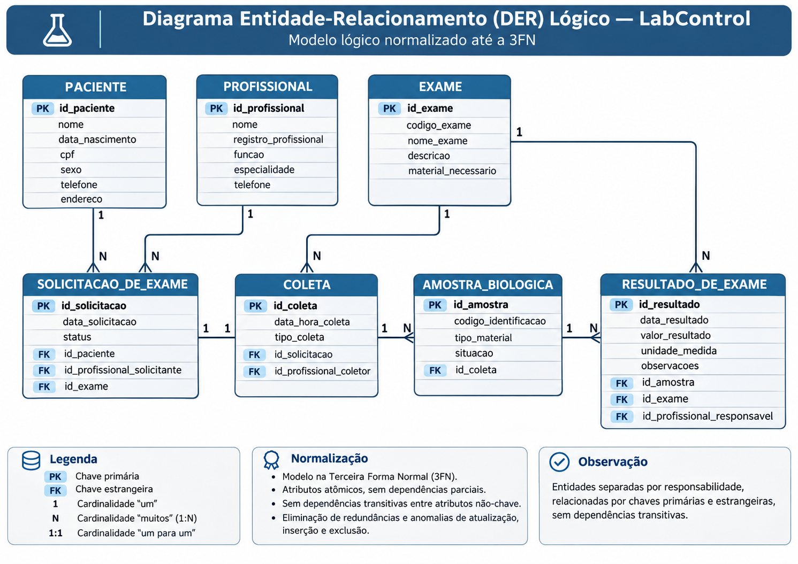

# Documentação técnica — LabControl

## Modelagem do banco de dados

Diagrama lógico do banco de dados relacional,
normalizado até a Terceira Forma Normal (3FN).

O modelo contempla sete entidades, chaves primárias,
chaves estrangeiras, relacionamentos e cardinalidades.
